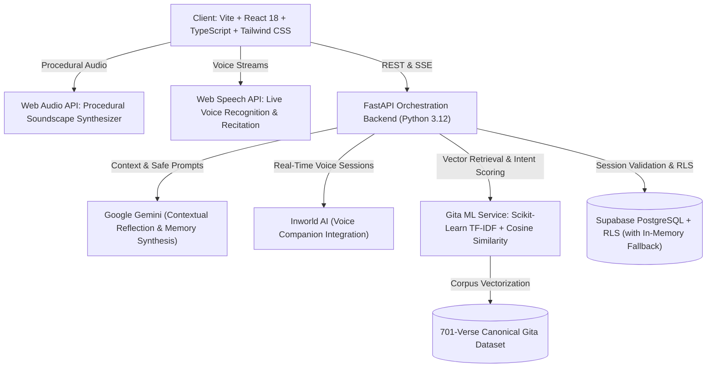

# Nirvana — Adaptive Multimodal Mental Wellness & Emotional Sanctuary

Nirvana is a private, calming, and adaptive mental-wellness sanctuary. 
It is **not** an AI therapist, medical diagnosis tool, or clinical questionnaire. 
Instead, Nirvana is an intimate personal space where you can speak, write, reflect, find grounding, explore timeless philosophical wisdom, or simply enjoy ambient calm.

---

## 🌿 Core Philosophy

- **"This is my space."** — No advertisements, no trackers, no public feeds, and no manipulative engagement streaks.
- **"It listens and remembers."** — Long-term context is preserved respectfully across sessions so you never have to re-explain yourself.
- **"Strict data sovereignty."** — Inspect every remembered fact, delete individual memories at will, export your data as JSON, or permanently purge your account in one click.
- **"Adaptive to your emotional energy."** — When you feel overwhelmed, Nirvana activates low-effort calm: breathing anchors, ambient soundscapes, or private journaling.
- **"Authentic scripture via Machine Learning."** — The Spiritual Corner uses a canonical 701-verse Kaggle Bhagavad Gita dataset with TF-IDF semantic vector search; the AI never hallucinates verses or chapters.

---

## 🏛 Architecture



---

## ✨ Key Features

### 1. Real-Time Spoken Companion ("Your Space")
- **Live 1-on-1 Voice Dialogue**: Continuous hands-free conversation with real-time speech recognition and voice responses.
- **Natural Spoken Cadence**: Spoken replies are specifically optimized (~28 words) for fluid vocal back-and-forth without long text monologues.
- **Async Memory Extraction**: Key facts and emotional context are extracted in non-blocking background tasks (`asyncio.create_task`), ensuring zero latency during conversation.
- **Quick-Action Anchors**: One-tap pills for *"Breathe with Nirvana"*, *"Let It Out in Journal"*, and *"Quiet Mode"*.
- **Ephemeral Toggle**: Per-message *"Don't remember this"* switch for completely unrecorded thoughts.
- **Deterministic Crisis Safety**: Automatic diversion to verified 24/7 helplines (Tele-MANAS, KIRAN, AASRA, Vandrevala, 988) if acute distress or danger is detected.

### 2. Machine Learning Bhagavad Gita Wisdom ("Spiritual Corner")
- **Canonical 701-Verse Dataset**: Grounded in the comprehensive Kaggle dataset (`a2m2a2n2/bhagwad-gita-dataset`).
- **TF-IDF & Cosine Similarity Semantic Search**: Fast in-memory NLP vectorizer indexing English translations, purports, transliterations, word meanings, and thematic tags.
- **Emotional Intent Classifier**: Automatically maps queries to core human dilemmas (restless mind, anxiety/fear, anger/frustration, grief/sadness, duty/indecision, peace/detachment, surrender/trust).
- **Zero Hallucination Guarantee**: Returns exact Chapter and Verse citations, authentic Sanskrit Devanagari, IAST transliteration, Hindi translation, English translation, and philosophical commentary.
- **Sanskrit Audio Recitation**: In-browser audio pronunciation for every shloka.
- **Interactive Chapter Explorer**: Explore all 18 chapters with summaries and verse listings.

### 3. Mindfulness & Grounding ("Take a Moment")
- **Visual Breathing Exercises**: 4-7-8 Relaxing Breath and Box Breathing with soothing expanding guide rings.
- **5-4-3-2-1 Sensory Grounding**: Step-by-step physical and mental orientation.
- **2-Minute Reset**: Quick contemplation and arrival ritual.
- **Pre & Post Ratings**: Measure shifts in tension before and after sessions.

### 4. Procedural Ambient Audio Engine
- Synthesized entirely in real time using the **Web Audio API** (zero heavy external audio files to download):
  - **Gentle Rain**: Calming filtered brown-noise raindrops.
  - **Ocean Waves**: Periodic 8-second tide surge and receding wash.
  - **Mountain Wind**: Dynamic airy breeze sweep.
  - **Tibetan Singing Bowl**: Resonant harmonic sine-wave chimes.
- Built-in volume slider and 5 / 15 / 30-minute sleep timers.

### 5. Private Journal ("Let It Out") & Non-Clinical Insights
- Distraction-free personal writing sanctuary with optional mood tags.
- Optional consensual reflection: *"Want me to sit with this?"* offers grounding observations only when requested.
- Longitudinal arrival check-ins (7, 30, and 90 days) showing constructive trends without medicalization or psychiatric grading.

### 6. Transparent Data Sovereignty ("Your Memory")
- Full list of all long-term context stored by Nirvana.
- Individual memory deletion ("forget this fact").
- One-click transparent JSON data export.
- Complete, permanent account and data purge.

---

## 📁 Project Structure

```
Nirvana/
├── backend/
│   ├── config.py              # Application settings & environment variables
│   ├── main.py                # FastAPI app entry point & CORS configuration
│   ├── requirements.txt       # Python dependencies (FastAPI, scikit-learn, etc.)
│   ├── data/
│   │   ├── Bhagwad_Gita.csv   # Raw 701-verse Kaggle dataset
│   │   └── gita_verses.json   # Structured multilingual Gita corpus
│   ├── database/
│   │   ├── schema.sql         # PostgreSQL schema with Row-Level Security
│   │   ├── apply_schema.py    # Supabase DDL migration helper
│   │   └── supabase_client.py # Database client with resilient memory fallback
│   ├── routers/               # API endpoints (companion, gita, journal, mood, etc.)
│   ├── services/
│   │   ├── gita_service.py    # Gita ML TF-IDF vectorizer & semantic search
│   │   ├── orchestrator.py    # Multi-turn conversation & voice dialogue coordinator
│   │   ├── memory_service.py  # Long-term memory extraction & retrieval
│   │   ├── safety_service.py  # Deterministic crisis & distress detection
│   │   └── inworld_service.py # Inworld AI voice session integration
│   └── tests/                 # Comprehensive Pytest test suite (11 tests)
├── frontend/
│   ├── index.html             # Single-page HTML entry point
│   ├── package.json           # Node dependencies (React 18, Vite, Lucide, Tailwind)
│   ├── vite.config.ts         # Vite build configuration
│   ├── tailwind.config.js     # Zen sanctuary color themes & tokens
│   └── src/
│       ├── App.tsx            # Main application router & modal state
│       ├── index.css          # Design system & ergonomic 110% root zoom base
│       ├── components/        # Views (Companion, Gita, Journal, Wellness, Insights, etc.)
│       ├── context/           # Theme context (Light / Dark mode)
│       └── utils/             # Ambient audio synthesizer & API client
└── README.md
```

---

## 🚀 Getting Started

### Prerequisites
- **Node.js**: v18+ and `npm`
- **Python**: v3.10+ (tested on Python 3.12)
- **API Keys (Optional)**: Google Gemini API key, Supabase credentials, Inworld AI credentials.  
  *(Nirvana includes offline fallbacks for all services if keys are not provided).*

---

### 1. Environment Setup

Copy `.env.example` to `.env`:
```bash
cp .env.example .env
```

Configure your environment variables:
```env
# Google Gemini
GEMINI_API_KEY=your_gemini_api_key

# Supabase (Optional for cloud sync; memory fallback runs automatically)
SUPABASE_URL=https://your-project.supabase.co
SUPABASE_ANON_KEY=your_anon_key
SUPABASE_SERVICE_ROLE_KEY=your_service_role_key

# Inworld AI (Optional for custom avatar voice sessions)
INWORLD_API_KEY=your_inworld_key
INWORLD_API_SECRET=your_inworld_secret
INWORLD_SCENE=your_inworld_scene
```

---

### 2. Backend Setup

```bash
# Create and activate virtual environment
python -m venv venv

# Windows:
.\venv\Scripts\activate
# macOS/Linux:
source venv/bin/activate

# Install dependencies
pip install -r backend/requirements.txt
```

#### Run Backend Tests
```bash
python -m pytest backend/tests -v
```
*(All 11 tests will execute verifying crisis detection, memory extraction, low-effort mode, and Gita ML retrieval).*

#### Start the Backend Server
```bash
python -m uvicorn backend.main:app --host 0.0.0.0 --port 8000 --reload
```
The FastAPI backend will start at **http://localhost:8000**. On initial boot, `GitaMLService` automatically loads the 701-verse corpus and trains the in-memory TF-IDF vectorizer.

---

### 3. Frontend Setup

In a separate terminal:
```bash
cd frontend
npm install
npm run dev
```

Open **http://localhost:5173** in your browser.

To create an optimized production build:
```bash
npm run build
```

---

## 🗄 Database Setup (Supabase)

Nirvana works immediately out-of-the-box with in-memory persistence. To enable persistent cloud storage across devices:

1. Create a project at [supabase.com](https://supabase.com).
2. Open the Supabase **SQL Editor** and execute:
   ```
   backend/database/schema.sql
   ```
3. Add your `SUPABASE_URL`, `SUPABASE_ANON_KEY`, and `SUPABASE_SERVICE_ROLE_KEY` to `.env`.
4. All tables include **Row Level Security (RLS)** ensuring complete data isolation per user.

---

## 🛡 Safety & Medical Disclaimer

Nirvana is an emotional wellness, personal reflection, and mindfulness tool. **It is not a clinical medical device, psychiatric healthcare provider, or emergency service.**

If anyone communicates acute self-harm, suicidal intent, or domestic danger, Nirvana immediately switches into **Safety Mode**, displaying verified national and international crisis helplines:
- **Tele-MANAS (India)**: 14416 / 1800-891-4416
- **KIRAN (India)**: 1800-599-0019
- **AASRA (India)**: +91 98204 66726
- **Vandrevala Foundation (India)**: +91 9999 666 555
- **988 Suicide & Crisis Lifeline (US/Canada)**: Call or text 988
